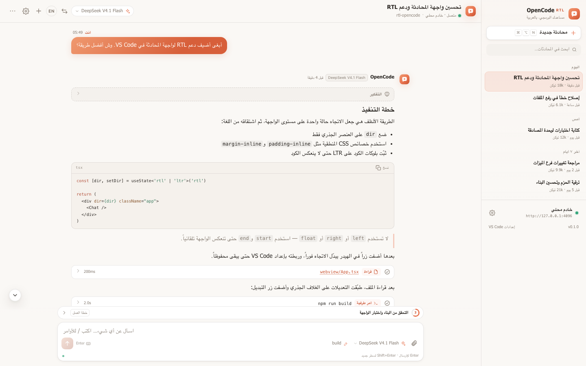

<div dir="rtl" align="right">

# OpenCode RTL

**واجهة محادثة عربية أولاً لـ [OpenCode](https://opencode.ai) داخل VS Code و Antigravity.**

الاتجاه، الخطوط، القوائم، بطاقات الأدوات والصلاحيات، والمحادثات كلها مصممة للعمل من اليمين إلى اليسار — مع إبقاء الأكواد والمسارات وأوامر الطرفية باتجاه LTR.

[](LICENSE)
[](https://code.visualstudio.com)
[](https://github.com/Moh-Hussain/opencode-rtl/releases)

[English](#english) · [التثبيت](#التثبيت) · [المزايا](#المزايا) · [المساهمة](#المساهمة)

</div>



<div dir="rtl" align="right">

## لماذا OpenCode RTL؟

- **عربي أولاً:** واجهة RTL كاملة، ونصوص إنجليزية تلقائية عند الحاجة.
- **محلي وآمن:** يتصل بخادم OpenCode المحلي فقط. لا تتبع، ولا خادم وسيط.
- **محادثة حقيقية:** بث مباشر للردود، التفكير، الأدوات، الصلاحيات والأسئلة.
- **ثنائي اللغة:** تبديل فوري بين العربية والإنجليزية مع الحفاظ على اتجاه الأكواد.
- **يعمل في المكانين:** الشريط الجانبي ولوحة المحرر، مع نفس الحالة والمحادثات.
- **مصمم للمطورين:** تمييز أكواد، فروقات ملفات، قوائم نماذج ووكلاء، واختصارات لوحة مفاتيح.

## المتطلبات

- VS Code `1.85` أو أحدث (أو Antigravity).
- OpenCode CLI مثبت ومهيأ:

```bash
opencode --version
opencode auth login
```

## التثبيت

**الطريقة الأسرع:** حمّل ملف `.vsix` من [أحدث إصدار](https://github.com/Moh-Hussain/opencode-rtl/releases/latest)، ثم:

```bash
code --install-extension opencode-rtl-0.1.0.vsix
```

أو من داخل VS Code: `Extensions` ← `...` ← `Install from VSIX...`.

**من المصدر:**

```bash
git clone https://github.com/Moh-Hussain/opencode-rtl.git
cd opencode-rtl
npm install
npm run package
code --install-extension opencode-rtl-0.1.0.vsix
```

## البدء

1. ثبّت الإضافة.
2. افتح لوحة OpenCode RTL من شريط النشاط، أو نفّذ `OpenCode RTL: Open Chat`.
3. ستبدأ الإضافة خادم OpenCode محلياً تلقائياً داخل مجلد المشروع.
4. اكتب رسالتك، أو استخدم زر `+` لبدء محادثة جديدة.

إذا كان لديك خادم OpenCode يعمل مسبقاً، ضع عنوانه في `opencodeRtl.serverUrl` وأوقف `opencodeRtl.autoStartServer`.

## المزايا

- محادثات متعددة مع بحث، تفريع وحذف.
- عرض مباشر لأدوات القراءة، الكتابة، البحث، والأوامر الطرفية.
- بطاقات صلاحيات وأسئلة مدمجة دون مغادرة المحادثة.
- قائمة مهام (Todos) أثناء تنفيذ الوكيل.
- عارض فروقات الملفات مع عدد الإضافات والحذوفات.
- اختيار النموذج والوكيل من الواجهة.
- أوامر سريعة: `/new`، `/clear`، `/export`، `/model`، `/agent`، `/rtl`، `/settings`.
- تصدير المحادثة إلى Markdown.
- حجم خط، اتجاه، لغة، ومفتاح إرسال قابلة للتخصيص.
- إرفاق التحديد من المحرر أو إرساله مباشرة كسؤال.

## الأوامر

| الأمر | الوصف |
| --- | --- |
| `OpenCode RTL: Open Chat` | فتح المحادثة في الشريط الجانبي |
| `OpenCode RTL: Open in Editor Panel` | فتح المحادثة في لوحة المحرر |
| `OpenCode RTL: New Session` | بدء محادثة جديدة |
| `OpenCode RTL: Send Selection` | إرسال النص المحدد إلى المحادثة |
| `OpenCode RTL: Explain Selection` | شرح النص المحدد |
| `OpenCode RTL: Fix Selection` | طلب إصلاح النص المحدد |
| `OpenCode RTL: Toggle Direction` | تبديل RTL / LTR |
| `OpenCode RTL: Pick Model` | اختيار النموذج |
| `OpenCode RTL: Pick Agent` | اختيار الوكيل |
| `OpenCode RTL: Restart Server` | إعادة تشغيل الخادم المحلي |
| `OpenCode RTL: Open Settings` | فتح إعدادات الإضافة |

## اختصارات لوحة المفاتيح

| الاختصار (macOS) | الاختصار (Windows/Linux) | الأمر |
| --- | --- | --- |
| `Cmd+Alt+O` | `Ctrl+Alt+O` | فتح المحادثة |
| `Cmd+Alt+N` | `Ctrl+Alt+N` | محادثة جديدة |
| `Cmd+Alt+R` | `Ctrl+Alt+R` | تبديل الاتجاه |
| `Cmd+Alt+E` | `Ctrl+Alt+E` | شرح التحديد |

## الإعدادات

| الإعداد | الافتراضي | الوصف |
| --- | --- | --- |
| `opencodeRtl.serverUrl` | `""` | عنوان خادم OpenCode خارجي (اتركه فارغاً للتشغيل التلقائي) |
| `opencodeRtl.autoStartServer` | `true` | تشغيل خادم محلي تلقائياً |
| `opencodeRtl.executable` | `"opencode"` | مسار أو اسم ملف OpenCode التنفيذي |
| `opencodeRtl.serverPassword` | `""` | كلمة مرور الخادم (أو استخدم `OPENCODE_SERVER_PASSWORD`) |
| `opencodeRtl.language` | `"auto"` | لغة الواجهة: تلقائي / عربي / إنجليزي |
| `opencodeRtl.direction` | `"auto"` | اتجاه الواجهة: تلقائي / RTL / LTR |
| `opencodeRtl.fontSize` | `14` | حجم خط المحادثة (11–22) |
| `opencodeRtl.defaultModel` | `""` | نموذج افتراضي، مثال: `anthropic/claude-sonnet-4` |
| `opencodeRtl.defaultAgent` | `""` | وكيل افتراضي، مثال: `build` |
| `opencodeRtl.showReasoning` | `false` | إظهار بطاقات التفكير افتراضياً |
| `opencodeRtl.autoAttachSelection` | `true` | إرفاق التحديد تلقائياً عند فتح المحادثة |
| `opencodeRtl.sendKey` | `"enter"` | الإرسال بـ Enter أو Ctrl/Cmd+Enter |
| `opencodeRtl.openIn` | `"sidebar"` | مكان الفتح الافتراضي: الشريط الجانبي أو اللوحة |

## الخصوصية

تعمل الإضافة كواجهة فقط. الرسائل والأكواد تُرسل إلى خادم OpenCode المحلي الذي تشغّل أنت، ثم إلى مزوّد النموذج الذي اخترته وفق إعدادات OpenCode لديك. لا تجمع الإضافة أي بيانات تحليلات ولا تتصل بأي خادم وسيط.

## المساهمة

المساهمات مرحّب بها:

1. افتح Issue لوصف المشكلة أو الاقتراح.
2. أنشئ فرعاً: `git checkout -b feat/my-change`.
3. تأكد من نجاح `npm run typecheck` و `npm run build`.
4. افتح Pull Request مع وصف واضح.

</div>

---

<a id="english"></a>

# OpenCode RTL

An Arabic-first, right-to-left chat interface for [OpenCode](https://opencode.ai) inside VS Code and Antigravity.

Direction, typography, navigation, tool and permission cards, and conversation flow are designed right-to-left — while code, paths, and terminal commands stay LTR.

## Features

- Full RTL Arabic UI with instant English switching and a persisted direction preference.
- Local-only connection to the OpenCode server you already use. No telemetry.
- Live streaming of replies, reasoning, tools, permissions, and questions.
- Sidebar and editor panel share the same session state.
- Session search, fork, delete, Markdown export, model/agent pickers, and todos.
- File diff viewer, inline permission cards, and editor selection actions.
- Slash commands: `/new`, `/clear`, `/export`, `/model`, `/agent`, `/rtl`, `/settings`.

## Requirements

- VS Code `1.85+` or Antigravity.
- OpenCode CLI installed and authenticated: `opencode auth login`.

## Install

Download the latest `.vsix` from [Releases](https://github.com/Moh-Hussain/opencode-rtl/releases/latest), then:

```bash
code --install-extension opencode-rtl-0.1.0.vsix
```

Or build from source:

```bash
git clone https://github.com/Moh-Hussain/opencode-rtl.git
cd opencode-rtl
npm install
npm run package
code --install-extension opencode-rtl-0.1.0.vsix
```

## Getting started

1. Install the extension.
2. Open OpenCode RTL from the activity bar, or run `OpenCode RTL: Open Chat`.
3. The extension starts a local OpenCode server in your workspace automatically.
4. Start typing, or press `+` for a new session.

To use an existing server, set `opencodeRtl.serverUrl` and disable `opencodeRtl.autoStartServer`.

## Commands and shortcuts

| Command | macOS | Windows/Linux |
| --- | --- | --- |
| Open chat | `Cmd+Alt+O` | `Ctrl+Alt+O` |
| New session | `Cmd+Alt+N` | `Ctrl+Alt+N` |
| Toggle direction | `Cmd+Alt+R` | `Ctrl+Alt+R` |
| Explain selection | `Cmd+Alt+E` | `Ctrl+Alt+E` |

All commands are also available from the Command Palette and the editor context menu under **OpenCode RTL**.

## Settings

See the Arabic settings table above for the full list. Main options: `serverUrl`, `autoStartServer`, `executable`, `serverPassword`, `language`, `direction`, `fontSize`, `defaultModel`, `defaultAgent`, `showReasoning`, `autoAttachSelection`, `sendKey`, and `openIn`.

## Development

```bash
npm install
npm run typecheck    # typecheck extension + webview
npm run build        # bundle to dist/
npm run preview      # preview the UI in a browser
npm run package      # build a .vsix
```

Preview requires `npm run build` first. The `preview*.html` and `scripts/` files are excluded from the VSIX.

### Project structure

| Path | Purpose |
| --- | --- |
| `src/extension.ts` | Extension activation and commands |
| `src/core/` | OpenCode server lifecycle, API client, session hub |
| `src/ui/` | Webview providers and HTML shell |
| `src/shared/` | Protocol and shared types |
| `webview/` | Preact chat UI, i18n, Markdown and diffs |
| `media/` | Icons and screenshot |

## Contributing

Issues and pull requests are welcome. Please run `npm run typecheck` and `npm run build` before opening a PR.

## License

MIT © [Mohamd Hussein](https://github.com/Moh-Hussain)
